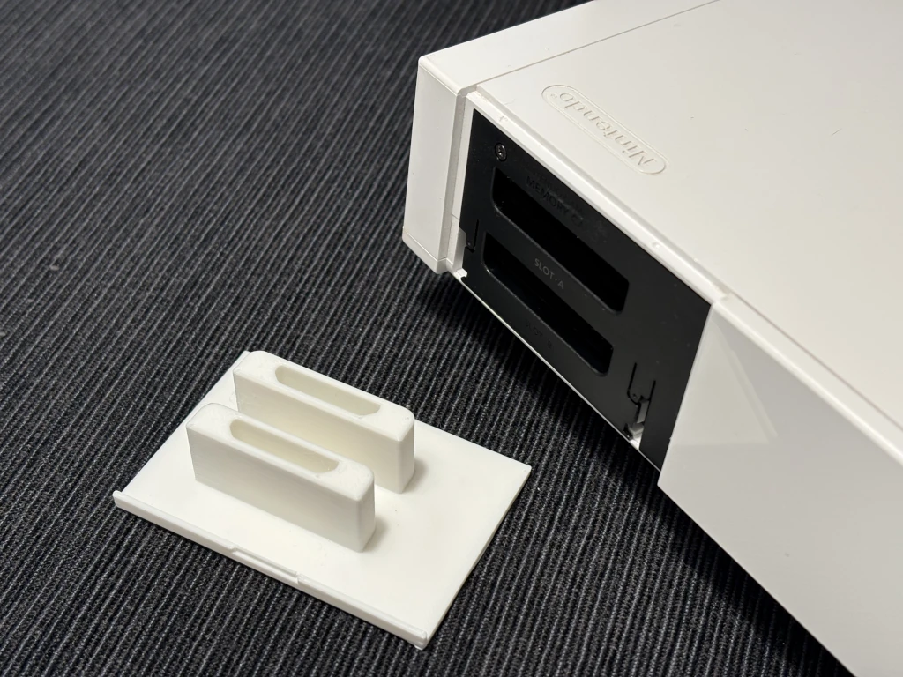
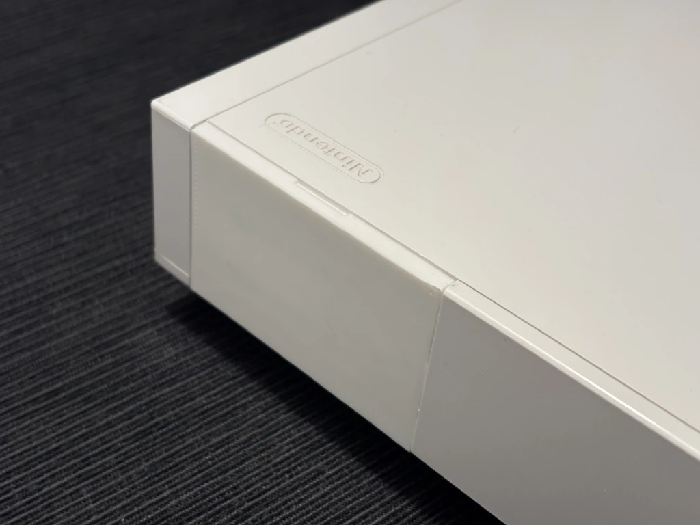

# Wii Memory Card Cover, Friction-Fit

A replacement cover that doesn't try to reproduce the hinge mechanism of the original. Not as fancy, but much less flimsy.
I suppose anyone who still takes GameCube gaming serious these days has an actual GameCube at home, so not much usability is lost.

FYI: Claude wrote the model, I measured and printed the prototypes.
